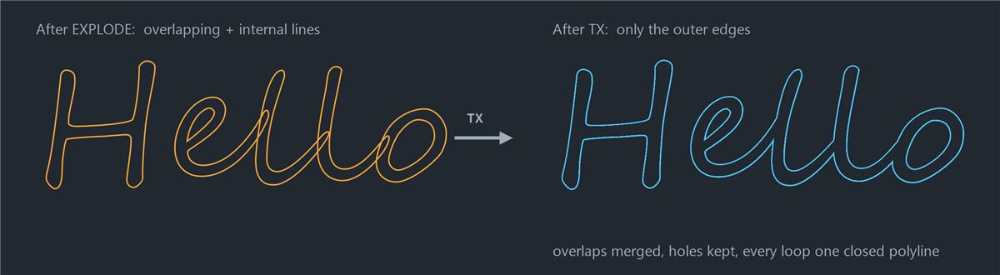

# Text to Outline for AutoCAD

**An AutoCAD plugin that explodes text into polylines with one command: `TX`.**

`TX` reads each text's own **text style** and its font, then draws the letters as polylines:

- **TrueType fonts** (Arial, Calibri…): **closed polylines that trace only the outer edges of the letters**.
  No overlapping lines, no internal lines, and holes (o, a, e, B, 8…) kept as their own closed polylines.
- **SHX fonts** (txt, romans, simplex, isocp…): the letters are single lines, so `TX` explodes them into
  **polylines along the letter strokes**, with real arcs where the font has arcs. That's the same lines AutoCAD draws.


---

## Why use it

Doing this by hand takes four steps, and they don't always give a clean result:

> **EXPLODE** the text → **OVERKILL** the duplicate lines → **delete** the internal lines by hand → **JOIN** the outer lines into polylines

`TX` does all four at once. It reads the exact letter shapes from the font and merges any overlapping
parts, which gives one closed polyline per edge:



### Features

- ✅ Works with **TEXT** and **MTEXT** (multi-line text too). Press **Enter** at the prompt to convert all text.
- ✅ Uses each text's **own text style**: the font file, bold/italic, width factor and oblique angle
- ✅ Any **TrueType font**: Arial, Times New Roman, Calibri, script fonts, bold and italic styles…
- ✅ Any **SHX font** (txt.shx, romans.shx, simplex.shx…, unifont SHX too), found the way AutoCAD finds it: support paths, then `FONTALT`
- ✅ Any **height, rotation, width factor, oblique angle, justification**, mirrored or upside-down text, any UCS
- ✅ Removes **overlaps and internal lines**, so touching letters become one shape
- ✅ Keeps **holes** as separate closed polylines (O = 2 polylines, B = 3)
- ✅ Outlines keep the text's **layer, color, linetype and lineweight**
- ✅ Choose to **keep or delete** the original text
- ✅ One **`U`** (undo) reverses the whole command
- ✅ No Express Tools needed

---

## Requirements

| | |
|---|---|
| AutoCAD | **AutoCAD 2019 or newer** (full version, 64-bit), including 2020. Not AutoCAD LT. |
| Windows | Windows 10 or 11 |
| Fonts | TrueType fonts must be installed in Windows. SHX fonts must be where AutoCAD finds them (its `Fonts` folder or a support path). |

---

## Step-by-step: install and use

### Step 1 — Download the plugin

Pick the file for your AutoCAD version. Click it and the download starts:

| Your AutoCAD | Download |
|---|---|
| **2019 – 2024** (including 2020) | **👉 [TextOutline.dll](https://github.com/lumidren/autocad-text-to-outline/releases/latest/download/TextOutline.dll)** |
| **2025 – 2026** | **👉 [TextOutline-AutoCAD-2025-2026.dll](https://github.com/lumidren/autocad-text-to-outline/releases/latest/download/TextOutline-AutoCAD-2025-2026.dll)** |
| **2027 and newer** | **👉 [TextOutline-AutoCAD-2027.dll](https://github.com/lumidren/autocad-text-to-outline/releases/latest/download/TextOutline-AutoCAD-2027.dll)** |

If a link doesn't start a download, open the [latest release](https://github.com/lumidren/autocad-text-to-outline/releases/latest)
and click the file name under **Assets**. The steps below call the file `TextOutline.dll`. If you downloaded
one of the other two, use that name instead.

> **Browser warning?** Browsers often warn about `.dll` files ("TextOutline.dll isn't commonly downloaded").
> In **Edge**: open Downloads (**Ctrl+J**) → hover the file → **⋯** → **Keep** → **Show more** → **Keep anyway**.
> In **Chrome**: open Downloads (**Ctrl+J**) → **Keep** / **Download suspicious file**.
>
> The file is the plugin built from the source code in this repository's `src` folder.

The file goes to your **Downloads** folder.

### Step 2 — Put it in a folder

1. Create a folder, for example:
   ```
   C:\AutoCAD Plugins\TextOutline
   ```
2. Move **`TextOutline.dll`** into that folder.

### Step 3 — Unblock the file (important!)

Windows blocks DLLs downloaded from the internet, and AutoCAD won't load a blocked file.

1. Right-click **`TextOutline.dll`** → **Properties**.
2. On the **General** tab, at the bottom, tick **☑ Unblock**.
3. Click **OK**.

> If you don't see an **Unblock** box, the file is already unblocked.

### Step 4 — Trust the folder in AutoCAD (recommended)

This stops the security warning from appearing every time the plugin loads.

1. Open AutoCAD and type **`OPTIONS`** → **Enter**.
2. Go to the **Files** tab.
3. Expand **Trusted Locations** → click **Add…** → **Browse…**.
4. Pick `C:\AutoCAD Plugins\TextOutline` → **OK** → **OK**.

### Step 5 — Load the plugin

1. Type **`NETLOAD`** → **Enter**.
2. Select **`TextOutline.dll`** → **Open**.
3. If a security dialog appears, click **Load**.
4. The command line confirms:
   ```
   Text to Outline loaded. Type TEXTOUTLINE (or TX) and select text.
   ```

> `NETLOAD` lasts until you close AutoCAD. To load the plugin automatically every time, see
> [Load automatically at startup](#load-automatically-at-startup).

### Step 6 — Convert your text

1. Write your text as usual with **`TEXT`** or **`MTEXT`**, in any text style (TrueType or SHX font).
2. Type **`TX`** → **Enter**.
3. **Select the text.** Click it or drag a window around it, then press **Enter**. To convert **all** text, just press **Enter** without selecting anything.
4. Answer the question:
   ```
   Delete original text? [Yes/No] <No>:
   ```
   - **Enter** or **N**: keep the text; the outlines are drawn on top of it.
   - **Y**: delete the text and keep only the outlines.
5. Done. The command line tells you what was made.

**What it looks like on the command line:**
```
Command: TX
Select text to convert to polylines [Enter = all text]: Specify opposite corner: 3 found
Select text to convert to polylines [Enter = all text]:
Delete original text? [Yes/No] <No>: Y
Created 31 polyline(s) from 3 text line(s): 2 in TrueType fonts (closed outlines), 1 in SHX fonts (letter strokes).
```

> **Tip:** you can also select the text first and then type `TX`.
>
> **Undo:** type **`U`** once to remove the outlines and bring back the deleted text.

### Step 7 — Check the result

- Move the original text away (or choose **Y** to delete it) to see the outlines on their own.
- **TrueType text:** click an outline. It is one **polyline**, and `LIST` shows it as **Closed**.
  The letter **H** gives 1 polyline, **O** gives 2 (outside + inside), **B** and **8** give 3.
- **SHX text:** each pen stroke of a letter is one polyline, exactly on the lines AutoCAD drew. An **O** is one
  closed polyline made of arcs, and an **E** in `txt.shx` is a few open polylines.

---

## Commands

| Command | What it does |
|---|---|
| **`TX`** | Convert selected text (or all text: press Enter) to polylines, using each text's style (short name) |
| **`TEXTOUTLINE`** | Same as `TX` (full name) |
| **`TXQUALITY`** | Set how smooth curved letters are: **Draft**, **Normal** (default), **Fine** |

### `TXQUALITY` — curve smoothness

Curved edges (o, s, c…) of TrueType letters are made of many short straight segments. Run `TXQUALITY` *before* `TX`:

| Option | Accuracy | Best for |
|---|---|---|
| **Draft** | 0.1 % of font size | Small text, light drawings |
| **Normal** | 0.02 % of font size | Everyday use (default) |
| **Fine** | 0.005 % of font size | Large signs, CNC / laser / plasma cutting |

SHX arcs stay true arcs. They are only split into segments when the text is stretched (width factor, Fit) or slanted. Then **Draft**, **Normal** and **Fine** use 4, 8 and 16 segments per 90°.

---

## Load automatically at startup

1. In AutoCAD type `(findfile "acaddoc.lsp")` → **Enter**.
   - If it shows a file path, open that file with Notepad.
   - If it shows `nil`, create a new file **`acaddoc.lsp`** in `C:\AutoCAD Plugins\TextOutline`, and add
     that folder in **OPTIONS → Files → Support File Search Path → Add… → Browse…**.
2. Add this line to `acaddoc.lsp` (use **forward slashes** `/`):
   ```lisp
   (command "_.NETLOAD" "C:/AutoCAD Plugins/TextOutline/TextOutline.dll")
   ```
3. Save the file and restart AutoCAD. `TX` is now ready in every drawing.

---

## Tips

| You want to… | Do this |
|---|---|
| Fill the letters | `HATCH` → pattern **SOLID** → click inside each letter. Holes stay empty. |
| Cut letters on CNC / laser | `TXQUALITY` → **Fine**, then `TX`. TrueType outlines are all closed. |
| Engrave or pen-plot single-line text | Use an SHX style (e.g. `romans.shx`), then `TX`: one polyline per stroke, no outline |
| Make a border around letters | `OFFSET` the outline polylines |
| Make 3D letters | `EXTRUDE` the outer outlines, `EXTRUDE` the holes, then `SUBTRACT` the holes |
| Convert all text in a drawing | `TX` → **Enter** (nothing selected) |

---

## Limitations

| Can't convert | What to do |
|---|---|
| SHX **big fonts** (Asian double-byte `.shx`) | Characters only in the big font are left out, and the command line counts them. Use a TrueType or unifont style. |
| SHX text as **closed outlines** | SHX letters are single lines with no thickness, so `TX` gives the strokes. For outlines, change the style to a TrueType font (`STYLE`) first. |
| Text inside **blocks** | `EXPLODE` the block first |
| **Attributes, dimensions, tables, leaders** | Explode them to TEXT/MTEXT first |
| **AutoCAD LT** | LT cannot load plugins |

---

## Troubleshooting

| Problem | Fix |
|---|---|
| `NETLOAD` fails / *"Cannot load assembly"* | The DLL is still blocked. Do [Step 3](#step-3--unblock-the-file-important), then restart AutoCAD. |
| *"Unknown command TX"* | The plugin isn't loaded. Run `NETLOAD` again ([Step 5](#step-5--load-the-plugin)). |
| `TX` runs a different command | Something else on your PC already uses `TX` (e.g. an alias in `acad.pgp`). Use **`TEXTOUTLINE`** instead. |
| *"font file not found (romans.shx)"* | AutoCAD can't find that SHX file either. Add its folder in **OPTIONS → Files → Support File Search Path**, or set `FONTALT` to a font you have. |
| *"N character(s) are not in their SHX font"* | The font has no letter for those characters (AutoCAD shows them as `?` or blank). Use a font that has them. |
| Curves look jagged on big text | `TXQUALITY` → **Fine**, then convert again. |
| Outline doesn't sit exactly on the text, or a *"proportions differ"* message | Please [open an issue](../../issues) with the font name, height, width factor and a screenshot. |

More detail: **[full user manual](docs/USER-MANUAL.md)**.

---

## For developers

<details>
<summary>How it works, building, and project layout</summary>

### How it works
1. Each text line is read with its own text style. A TrueType style goes through steps 2-5. An SHX style goes to step 6.
2. Letter outlines come straight from the font (GDI+ `GraphicsPath.AddString`) and curves become short segments.
3. Contours are marked **solid** or **hole** from their winding direction.
4. AutoCAD **regions** merge them, largest first: solids united, holes subtracted. This removes overlaps
   and internal lines and keeps islands inside holes (like the R in ®).
5. The merged boundary is joined into closed loops, then fitted onto the text's real position, size, rotation,
   width factor, slant and plane, and written as closed `LWPOLYLINE`s.
6. **SHX fonts:** `src/ShxFont.cs` reads the compiled `.shx` file (classic shapes and unifont) and runs its shape
   codes: vectors, pen up/down, scale, push/pop, subshapes, displacements, octant, fractional and bulge arcs.
   Each pen-down stroke becomes one `LWPOLYLINE` with bulges for arcs. It is scaled so the font's cap height
   equals the text height, then gets the width factor, oblique angle, mirroring, Fit/Aligned stretch,
   rotation and plane. The font file is found like AutoCAD does it, through the support paths and then `FONTALT`.

### Building
**All versions, no AutoCAD needed** (needs the [.NET 10 SDK](https://dotnet.microsoft.com/download/dotnet/10.0)). The AutoCAD API comes from
Autodesk's official [`AutoCAD.NET`](https://www.nuget.org/packages/AutoCAD.NET) NuGet packages:
```
dotnet build TextOutline.csproj -c Release
```
This creates `bin\x64\Release\net48\` (AutoCAD 2019-2024), `net8.0-windows\` (2025-2026) and `net10.0-windows\` (2027+).
CI ([build.yml](.github/workflows/build.yml)) runs this on every push and publishes the three DLLs as a release for each `v*` tag.

**AutoCAD 2019-2024 only, no SDK:** on a PC with AutoCAD installed, run:
```
build.bat
```
or pass the folder that contains `AcDbMgd.dll`, `AcCoreMgd.dll` and `AcMgd.dll`:
```
build.bat "D:\Autodesk\AutoCAD 2020"
```
The output is `bin\TextOutline.dll`.

### Testing without AutoCAD
`test\ShxTest.cs` builds small `.shx` files byte by byte (classic and unifont) and checks the strokes that every
shape code draws, including arcs, subshapes and flattening. CI runs it on every push.

`test\OutlineTest.cs` renders several fonts and checks, pixel by pixel, that the merged outline matches the
font's real shape ([result](docs/outline-test.png)). `test\MakeDocImages.cs` generates the pictures in `docs/`.

### Project layout
```
src/Commands.cs         AutoCAD commands, merging and polyline output
src/GlyphOutline.cs     reads letter outlines from TrueType fonts
src/ShxFont.cs          reads SHX fonts and draws their letter strokes
test/                   geometry test and doc image generator
docs/USER-MANUAL.md     full user manual
TextOutline.csproj      builds all three AutoCAD versions
build.bat               build script (AutoCAD 2019-2024, no SDK)
```
</details>
