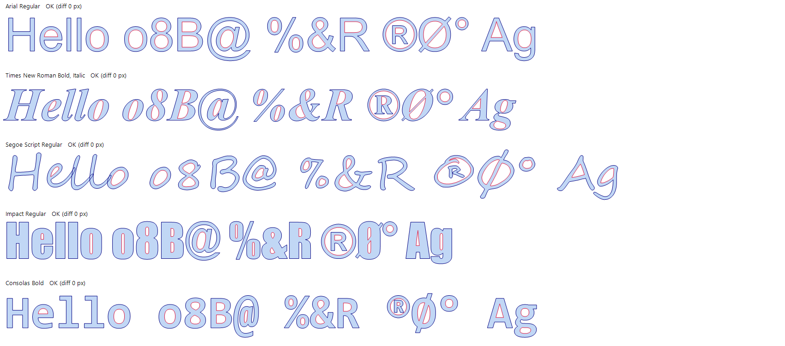

# autocad-text-to-outline

An **AutoCAD 2020 plugin (.NET DLL)** that converts TEXT and MTEXT in any TrueType font, at any height,
into **clean closed polylines that trace the outer edges of the letters**. No overlapping or internal
lines are left, and holes (o, a, B, 8…) are kept as their own closed polylines.

It replaces the manual routine **EXPLODE → OVERKILL → delete internal lines → JOIN** with one command: `TXO`.



## Quick start

1. Copy [`bin/TextOutline.dll`](bin/TextOutline.dll) to a folder, e.g. `C:\AutoCAD Plugins\TextOutline`.
2. Right-click the DLL → **Properties** → tick **Unblock** → **OK**.
3. In AutoCAD 2020: `NETLOAD` → choose `TextOutline.dll` → **Load**.
4. Type **`TXO`**, select your text, press **Enter**, then answer *Delete original text? [Yes/No]*.

## Commands

| Command | Description |
|---|---|
| `TEXTOUTLINE` / `TXO` | Convert selected TEXT/MTEXT to closed outline polylines |
| `TXOQUALITY` | Curve smoothness: Draft / Normal / Fine |

## Documentation

The full step-by-step guide covers installing, auto-loading at startup, options, tips and troubleshooting:
**[docs/USER-MANUAL.md](docs/USER-MANUAL.md)**

## Limitations

- SHX fonts (txt.shx, romans.shx…) are single-stroke fonts with no outline. Switch the style to a TrueType font first.
- Text inside blocks, attributes and dimensions must be exploded to TEXT/MTEXT first.
- Not for AutoCAD LT.

## Building

Run `build.bat` on a PC with AutoCAD 2020 installed (uses the C# compiler included with Windows; no Visual Studio needed).
See [section 12 of the manual](docs/USER-MANUAL.md#12-building-the-dll-yourself).

## Project layout

```
bin/TextOutline.dll     ready-to-use plugin for AutoCAD 2020
src/Commands.cs         AutoCAD commands, merge (regions) and polyline output
src/GlyphOutline.cs     reads letter outlines from TrueType fonts
test/OutlineTest.cs     geometry test that runs without AutoCAD
build.bat               builds bin/TextOutline.dll
docs/USER-MANUAL.md     user manual
```
