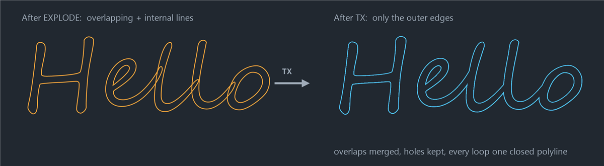

# Text to Outline for AutoCAD 2020 — User Manual

This plugin turns AutoCAD **TEXT** and **MTEXT** into **closed polylines that trace the outer edges of the letters**.
It does in one command what you would otherwise do by hand:

| Manual way | What the plugin does |
|---|---|
| 1. EXPLODE the text (or TXTEXP) | Reads each letter's exact shape from the font |
| 2. OVERKILL duplicate lines | No duplicates are ever created |
| 3. Delete internal / overlapping lines | Overlapping letter parts are merged automatically |
| 4. JOIN the outer lines into polylines | Every outline comes out as one closed polyline |

The result is one closed polyline for each outer edge and one for each hole
(the inside of **o, a, e, A, B, R, 8, @**…). It works with any TrueType font, any text height,
rotation, width factor, oblique (slant) angle, justification, and mirrored or upside-down text.




> **Quick reference:** `NETLOAD` the DLL once per session → type **`TX`** → select text → **Enter** →
> answer *Delete original text? [Yes/No]*. Use `TXQUALITY` to change curve smoothness and `U` to undo.

---

## Contents

1. [Requirements](#1-requirements)
2. [Installing the plugin](#2-installing-the-plugin)
3. [Loading the plugin in AutoCAD](#3-loading-the-plugin-in-autocad)
4. [Loading it automatically every time AutoCAD starts](#4-loading-it-automatically-every-time-autocad-starts)
5. [Converting text to outlines (step by step)](#5-converting-text-to-outlines-step-by-step)
6. [Commands reference](#6-commands-reference)
7. [What you get](#7-what-you-get)
8. [Tips](#8-tips)
9. [What the plugin cannot convert](#9-what-the-plugin-cannot-convert)
10. [Troubleshooting](#10-troubleshooting)
11. [Uninstalling](#11-uninstalling)
12. [Building the DLL yourself](#12-building-the-dll-yourself)

---

## 1. Requirements

- **AutoCAD 2020** (64-bit, Windows). It should also work in AutoCAD 2021–2024, but it was built for 2020.
  It does **not** load in AutoCAD LT (LT does not support plugins).
- The file **`TextOutline.dll`**, found in the `bin` folder of this repository.
- The fonts used by your text must be installed on the computer (the same fonts AutoCAD uses to display it).

Express Tools are **not** needed.

---

## 2. Installing the plugin

**Download** the plugin first:
- Direct download: <https://github.com/lumidren/autocad-text-to-outline/raw/main/bin/TextOutline.dll>
- Or open [`bin/TextOutline.dll`](../bin/TextOutline.dll) on GitHub → **⬇ Download raw file** (top right).
- Or the whole project: green **`<> Code`** button on the repository page → **Download ZIP**
  (unblock the ZIP *before* extracting it, see step 3 below).

If the browser warns that the `.dll` "isn't commonly downloaded", open its Downloads list (**Ctrl+J**)
and choose **Keep** / **Keep anyway**.

Then install it:

1. Create a folder for the plugin, for example:
   ```
   C:\AutoCAD Plugins\TextOutline
   ```
2. Copy **`TextOutline.dll`** into that folder.
3. **Unblock the file.** Windows blocks DLLs that come from the internet, email, USB or a zip file,
   and AutoCAD then refuses to load them.
   - Right-click `TextOutline.dll` → **Properties**.
   - At the bottom of the **General** tab, if there is a **Security: "This file came from another computer…"**
     line, tick **Unblock** → **OK**.
   - If there is no such line, the file is already unblocked.
4. *(Recommended)* Add the folder to AutoCAD's **Trusted Locations** so AutoCAD does not show a
   security warning every time:
   - In AutoCAD type **`OPTIONS`** → **Files** tab → expand **Trusted Locations** → **Add…** →
     **Browse…** and choose `C:\AutoCAD Plugins\TextOutline` → **OK**.

---

## 3. Loading the plugin in AutoCAD

1. Open AutoCAD 2020 and any drawing.
2. Type **`NETLOAD`** and press **Enter**.
3. Browse to `C:\AutoCAD Plugins\TextOutline\TextOutline.dll` and click **Open**.
4. If a **Security – Unsigned Executable File** dialog appears, click **Load** (or **Always Load**).
   *(This dialog does not appear if you added the folder to Trusted Locations.)*
5. The command line shows:
   ```
   Text to Outline loaded. Type TEXTOUTLINE (or TX) and select text.
   ```

The plugin stays loaded until you close AutoCAD. With this method you need to `NETLOAD` it again
after every restart; see the next section to load it automatically.

---

## 4. Loading it automatically every time AutoCAD starts

Use the `acaddoc.lsp` file, which AutoCAD runs every time it opens a drawing.

1. In AutoCAD type:
   ```
   (findfile "acaddoc.lsp")
   ```
   - If it returns a path, open that file in Notepad.
   - If it returns `nil`, create a new text file named **`acaddoc.lsp`** in the plugin folder
     `C:\AutoCAD Plugins\TextOutline\`, and add that folder to AutoCAD's support paths:
     **OPTIONS** → **Files** → **Support File Search Path** → **Add…** → **Browse…** → choose the folder.
2. Add this line to `acaddoc.lsp` (note the **forward slashes**):
   ```lisp
   (command "_.NETLOAD" "C:/AutoCAD Plugins/TextOutline/TextOutline.dll")
   ```
   It runs for every drawing you open. Loading the same DLL again is harmless: AutoCAD keeps the copy that is already loaded.
3. Save the file and restart AutoCAD. The "Text to Outline loaded" message appears on the command line.

---

## 5. Converting text to outlines (step by step)

1. Make sure the text uses a **TrueType font** (see [section 9](#9-what-the-plugin-cannot-convert)).
   In the **STYLE** dialog, TrueType fonts have a **TT** icon (Arial, Times New Roman, Calibri, Segoe Script…).
2. Type **`TEXTOUTLINE`** (or the short alias **`TX`**) and press **Enter**.
3. **Select the text.** You can pick single TEXT and MTEXT objects, use a window, or type `ALL`.
   Other object types are ignored automatically. Press **Enter** when done.
   *(You can also select the text first and then type `TX`.)*
4. The command asks:
   ```
   Delete original text? [Yes/No] <No>:
   ```
   - Press **Enter** (or type **N**) to **keep** the text. The outlines are drawn on top of it.
   - Type **Y** to **delete** the text and keep only the outlines.

   Your answer becomes the default the next time.
5. The command line reports the result, for example:
   ```
   Created 24 outline polyline(s) from 3 text object(s).
   ```

**Undo:** one **`U`** removes everything the command created and restores any deleted text.

**The whole session on the command line:**
```
Command: TX
Select text to convert to outline polylines: Specify opposite corner: 3 found
Select text to convert to outline polylines:
Delete original text? [Yes/No] <No>: Y
Created 24 outline polyline(s) from 3 text object(s).
```

### Example

1. Type `TEXT`, pick a point, height `50`, rotation `0`, type `Hello` and press Enter twice.
2. Type `TX`, pick the text, press Enter, then press Enter again (keep the text).
3. Move the text away (`MOVE`) to see the outlines underneath: 5 outer outlines (H, e, l, l, o)
   and 2 hole outlines (inside e and o), each one a closed polyline.

---

## 6. Commands reference

| Command | What it does |
|---|---|
| **`TEXTOUTLINE`** | Converts selected TEXT/MTEXT into closed outline polylines. |
| **`TX`** | Short alias for `TEXTOUTLINE`. |
| **`TXQUALITY`** | Sets how smooth curved letters are: **Draft**, **Normal** (default) or **Fine**. |

### TXQUALITY — curve smoothness

Curved letter edges (o, s, c…) are made of many short straight segments.

| Setting | Max. deviation from the true curve | Use it for |
|---|---|---|
| **Draft** | 0.1 % of the font size | Fast, light drawings, very small text |
| **Normal** | 0.02 % of the font size | Most work (default) |
| **Fine** | 0.005 % of the font size | Very large text, signs, CNC / laser cutting |

The setting lasts until AutoCAD is closed.

---

## 7. What you get

- **Closed lightweight polylines (LWPOLYLINE)**, one per outline. Check one with `LIST`: it shows `Closed`.
- **Outer edges and holes are separate polylines.** The letter **O** gives 2 polylines (outside + inside),
  **B** gives 3, **8** gives 3, **H** gives 1.
- **No internal lines and no duplicates.** Where letter strokes overlap (script fonts, joined letters,
  bold styles) the outline goes around the combined shape.
- **Letters that touch or overlap are merged into one outline**, exactly like the shape you see on screen.
- The polylines take the original text's **layer, color, linetype and lineweight**.
- They are drawn in the **same plane** as the text (works in any UCS and with rotated/3D text).
- MTEXT with several lines or paragraphs: every line is converted.

---

## 8. Tips

- **Filled letters:** run `HATCH`, choose a SOLID pattern, and pick inside each letter, or select the
  outlines with **Select objects**. Holes stay empty because they are separate closed boundaries.
- **CNC, laser, plasma, vinyl cutting:** use **TXQUALITY → Fine** for large text. All outlines are
  closed, which most CAM software requires.
- **Offset outlines** (for a border or tool path): `OFFSET` works directly on the result polylines.
- **Extruded 3D letters:** `EXTRUDE` the outer polylines, then `SUBTRACT` the extruded holes.
- **Converting many texts at once:** type `TX`, then `ALL` at the selection prompt.
- **Change the font first:** if your text uses an SHX font, change its text style to a TrueType font
  (`STYLE` command), then run `TX`.

---

## 9. What the plugin cannot convert

| Not supported | Why / what to do |
|---|---|
| **SHX fonts** (txt.shx, simplex.shx, romans.shx, isocp.shx…) | SHX letters are single lines with no thickness, so there is no outer edge to trace. Change the text style to a TrueType font first. The command lists the skipped SHX fonts on the command line. |
| Text inside **blocks** | `EXPLODE` the block (or edit it with `BEDIT`/`REFEDIT`), then run `TX`. |
| **Attributes**, dimension text, table text, leader text | Explode them to plain TEXT/MTEXT first (`BURST` from Express Tools converts attributes to text). |
| Text that uses a font **not installed** on this computer | Install the font, or change the text style to an installed font. |
| **AutoCAD LT** | LT cannot load plugins. |

---

## 10. Troubleshooting

| Problem | Solution |
|---|---|
| `NETLOAD` does nothing / *"Cannot load assembly"* / *"Operation is not supported"* | The DLL is blocked by Windows. Unblock it ([section 2](#2-installing-the-plugin), step 3) and restart AutoCAD. |
| *"Unknown command TX"* | The plugin is not loaded in this AutoCAD session. Run `NETLOAD` again or set up auto-loading ([section 4](#4-loading-it-automatically-every-time-autocad-starts)). |
| `TX` starts a different command | Another alias or plugin on this PC already uses `TX` (for example in `acad.pgp`). Use the full name **`TEXTOUTLINE`** instead. |
| Security warning every time it loads | Add the plugin folder to **Trusted Locations** ([section 2](#2-installing-the-plugin), step 4). |
| *"Skipped N text(s) using SHX fonts"* | That text uses a single-stroke SHX font. Change its style to a TrueType font. |
| *"Created 0 outline polyline(s)"* | The selection contained only empty text, or only SHX text. |
| *"…proportions differ from the text by more than 3%"* | The outline may not line up exactly with that text. Please report it with the font name, height and width factor (see below). |
| Curves look faceted on very large text | `TXQUALITY` → `Fine`, then convert again. |
| A different font shape than expected | AutoCAD shows a substitute when a font is missing. Install the real font so the outline matches. |

**Reporting a problem:** please include your AutoCAD version, the font name, the text height,
width factor, oblique angle and justification, the full command-line message, and a screenshot.

---

## 11. Uninstalling

1. Remove the `NETLOAD` line from `acaddoc.lsp` (if you added it).
2. Close AutoCAD.
3. Delete the `C:\AutoCAD Plugins\TextOutline` folder.
4. Optionally remove the folder from **OPTIONS** → **Files** → **Trusted Locations** / **Support File Search Path**.

Outlines you already created are normal polylines and stay in your drawings.

---

## 12. Building the DLL yourself

You only need this if you change the source code. No Visual Studio is required: the build uses the C#
compiler that comes with Windows.

On a computer with AutoCAD 2020 installed, open a Command Prompt in the repository folder and run:
```
build.bat
```
If AutoCAD is installed somewhere else, pass the folder that contains `AcDbMgd.dll`, `AcCoreMgd.dll` and `AcMgd.dll`:
```
build.bat "D:\Autodesk\AutoCAD 2020"
```
The new DLL is written to `bin\TextOutline.dll`.

### How it works (for developers)

1. Each TEXT (and each line of an exploded MTEXT) is read with its text style's TrueType font, bold and italic settings.
2. The letter outlines are read from the font with GDI+ (`GraphicsPath.AddString`) and curves are
   flattened to short line segments (`TXQUALITY`).
3. Contours are classified as **solid** or **hole** from their winding direction. The largest
   contour is always an outer one, so its direction defines "solid".
4. The contours are merged with AutoCAD **regions**, largest first: solids are united and holes are subtracted.
   This removes overlaps and internal lines and keeps islands inside holes (e.g. the R inside ®).
5. The merged region's boundary is exploded and the segments are joined end-to-end into closed loops.
   Collinear points are removed.
6. The loops are scaled and placed onto the text's real extents in the text's own coordinate system
   (handles height, width factor, oblique, rotation, justification, mirroring and the text plane),
   then written as closed `LWPOLYLINE`s.

`test\OutlineTest.cs` checks steps 2–4 without AutoCAD. It renders several fonts and compares the merged result
with the font's own filled shape pixel by pixel.
